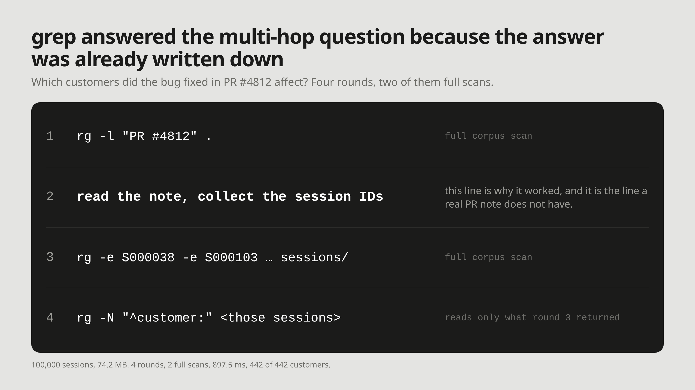

# M11: grep answered the multi-hop question because the answer was already written down

**For:** Cognee's LinkedIn and X. **LinkedIn length:** 133 words. **X length:** 202 characters.

## LinkedIn

"Which customers did PR #4812's bug affect?" Over 100,000 synthetic support sessions, grep answered it: 4 rounds, 2 full scans, 897.5 ms, all 442 affected customers.

There is a catch, and it is in our test data. The PR note ends with "Reported in sessions:" and every session ID that hit the bug. Real PR notes name a module and a symptom, never the sessions. Without that line, the third round has nothing to search for.

So grep didn't find the connection. Someone had already written it down.

That is the case for building links at write time instead of hoping they are in the text. Cognee's code graph does it for repositories: it extracts calls and imports across files, so "which functions call process_payment?" is answered from edges, not a fresh scan.

## X

grep found all 442 customers hit by PR #4812 across 100k sessions: 4 rounds, 2 scans.

Only because our test PR note lists every affected session. Real ones don't.

Build the links when memory is written.

## What we did not measure

- Whether Cognee answers the same question in fewer hops. `demos/01-cognee-vs-grep/compare.py` puts the same four questions to both; its Cognee column has not been run yet.
- Code-graph traversal on a real repository. What the pipeline extracts is read from Cognee's docs and its 1.6.1 source (`tasks/code_graph/code_repo.py`: cross-file `calls`/`imports` edges), not from a run here.

## Source

- `experiments/grep_memory/results.json`, `sessions: 100000`, `multi_hop`: 4 rounds, 2 full corpus scans, 897.5 ms, 442 of 442 customers. The 1,000- and 10,000-session records carry the same 4 rounds and 2 scans.
- The PR note is synthetic and lists the affected session IDs: `experiments/grep_memory/make_corpus.py`.
- [When grep Works as Agent Memory, and When It Fails](https://github.com/yashksaini-coder/cognee-memory-experiments/blob/main/articles/01-grep-as-agent-memory.md), "Multi-hop questions multiply the scans" and Limits.
- [Code graph pipeline](https://docs.cognee.ai/guides/code-graph), Cognee docs.
