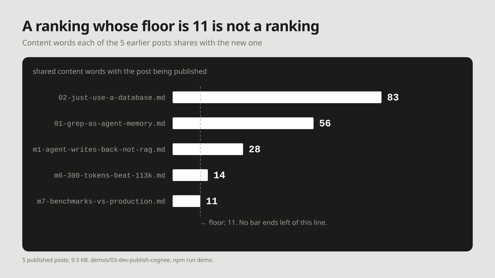

# M9: A ranking whose floor is 11 is not a ranking

**For:** Cognee's LinkedIn and X. **LinkedIn length:** 126 words. **X length:** 195 characters.

## LinkedIn

Before a blog publishes a new post, it should know which earlier post already covered the ground. We tested how far word matching gets on an archive of 5 posts.

It matched all 5. Shared content words, post by post: 83, 56, 28, 14, 11. No post scored zero. A ranking whose floor is 11 is not a ranking: it says every earlier post touched the topic, not which one covered it.

Then we asked Cognee the same question over the same archive. Its search returned a ranking with a clear top: the long version of the new post first, at 0.816, down to 0.640 for the least related.

Word overlap tells you the topic is familiar. Retrieval by meaning tells you which post to link.

## X

Word overlap matched all 5 earlier posts in our archive. Even the weakest shared 11 words, so nothing ranked.

Cognee's search over the same archive put the right post first: 0.816, down to 0.640.

## Source

- `demos/03-dev-publish-cognee`, `npm run demo` in [yashksaini-coder/cognee-memory-experiments](https://github.com/yashksaini-coder/cognee-memory-experiments). Offline rows, re-run 19 Oct 2026: `word overlap  5/5`, per-post 56 / 83 / 28 / 14 / 11, `(0/5 prior posts share no content word with this one)`.
- Cognee row, run 22 Oct 2026 with `@cognee/cognee-ts` 0.2.0 (`search`, `CHUNKS`), claude-haiku-4-5 + `nomic-embed-text` embeddings: `02-just-use-a-database.md` 0.816, m1 0.757, 01 0.738, m7 0.702, m6 0.640. Verbatim output in the demo's README.
